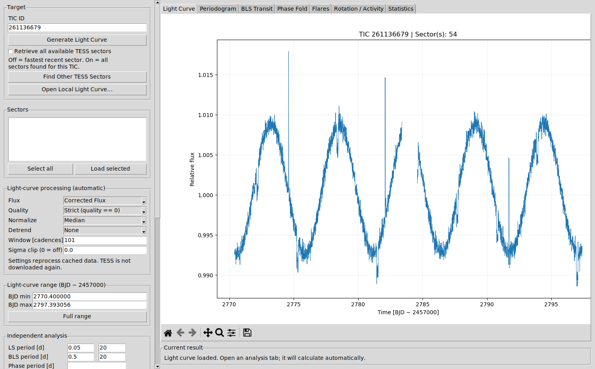
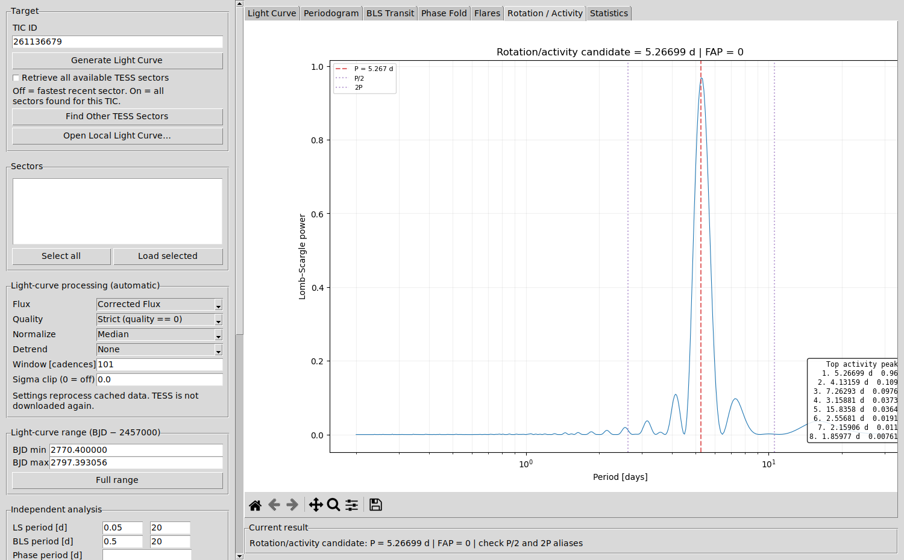
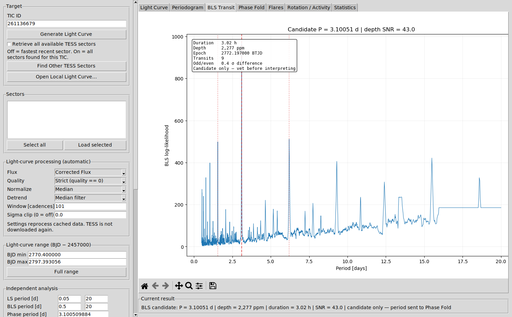
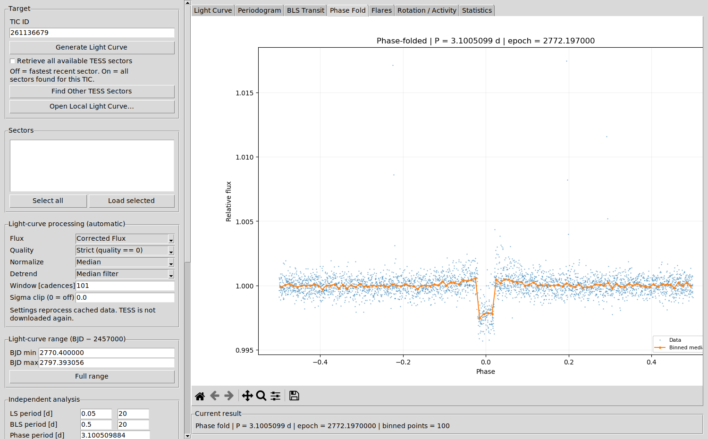
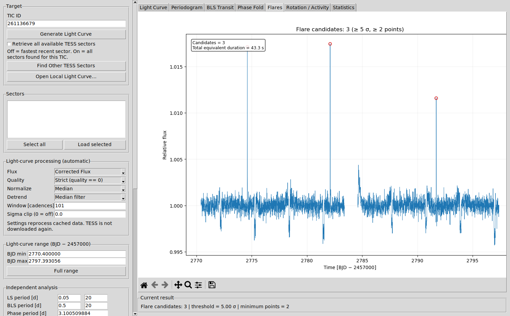

# 🔭 TESS Stellar Analysis Suite


A desktop application for retrieving, processing, visualizing and analyzing **TESS** light curves from a
**TIC ID**. It combines light-curve extraction with [`eleanor`](https://github.com/afeinstein20/eleanor)
and a complete first-pass time-series workflow: Lomb–Scargle periodograms, BLS transit screening,
phase folding, flare screening, stellar rotation/activity analysis, statistics and export.

Developed by **Javed Iqbal**, **Dr. Ahmed Waqas Zubairi** and **Dr. Shaukat Goderya**.



---

## Features

| | |
|---|---|
| **TESS retrieval** | From a TIC ID with Eleanor: the most recent sector (fast) or all available sectors |
| **Local files** | Open the suite's own CSV/FITS exports, TESS SPOC/QLP light-curve FITS, or any time–flux CSV |
| **Processing** | Raw / corrected / PCA flux, quality filtering, normalization, gap-aware detrending, sigma clipping |
| **Lomb–Scargle** | Best period, power, false-alarm probability and the strongest distinct peaks |
| **BLS transit screening** | Period, depth, duration, epoch, depth SNR, transit count and an odd/even depth test |
| **Phase fold** | Manual period/epoch or transferred automatically from BLS, with binned median |
| **Flare screening** | Robust-statistics detection with timing, amplitude, duration, significance and equivalent duration |
| **Rotation / activity** | Rotation-range periodogram with P/2 and 2P alias markers |
| **Statistics** | Cadence, time span, flux statistics, RMS, robust and point-to-point scatter in ppm |
| **Export** | Processed light curve (CSV, FITS), metadata JSON, analysis JSON with parameters, plots (PNG/PDF/SVG) |
| **Responsive** | Downloads and analyses run in background threads; processing changes re-use cached data |

## Screenshots

| Rotation / activity | BLS transit search |
|---|---|
|  |  |
| **Phase fold** | **Flare screening** |
|  |  |

*The screenshots show the built-in test star: a synthetic TESS sector with a 3.1-day transiting planet,
5.3-day starspot rotation and three flares. The suite recovers all three signals.*

## Installation

A clean Conda environment is recommended because Eleanor needs specific versions of Photutils,
TensorFlow, Astropy and NumPy:

```bash
conda create -n tess-analysis python=3.11
conda activate tess-analysis
pip install -r requirements.txt
```

On some Linux systems Tkinter must be installed separately (e.g. `sudo apt install python3-tk`).

## Running

```bash
conda activate tess-analysis
python run.py
```

Non-fatal warnings from Lightkurve or TensorFlow at start-up (for example about `oktopus`) are normal.

## Workflow

1. Enter a **TIC ID** and click **Generate Light Curve**. Tick *Retrieve all available TESS sectors* for a
   longer baseline, or use **Find Other TESS Sectors** → select → **Load selected**.
   Alternatively, click **Open Local Light Curve…** to analyse a file.
2. Inspect the **Light Curve** tab. Adjust *Flux*, *Quality*, *Normalize*, *Detrend*, *Window* and
   *Sigma clip*. Changes are applied automatically from cached data, without downloading again.
3. Open any analysis tab; it calculates automatically. After the first run, changing its parameters,
   the BJD range or the processing re-runs it.
4. **Run BLS** sends its candidate period and epoch to **Phase Fold** automatically.
5. **Export** the light curve, metadata, analysis JSON and figures for your research record.

**Tips for transit searches.** Detrend with the *Median filter* and a window at least three times
the transit duration. At 10-minute cadence, the default 101 cadences is about 0.7 days. The
Savitzky–Golay filter follows short dips more closely and makes transits shallower.

Times are in **BTJD = BJD_TDB − 2457000** throughout, as in TESS data products.

## Scientific caution

The outputs are screening results that need interpretation. A BLS detection is a **candidate**, not a
planet, and periodogram peaks can be harmonics, aliases or systematics. Flare candidates also need
visual vetting. Before publishing, check individual transits, odd/even depths, nearby contaminating
stars and centroids, and reproduce the result with an alternative processing configuration. See the
[user manual](docs/TESS_Stellar_Analysis_Suite_User_Manual.pdf) for the recommended research workflow.

## Testing

The test-suite runs without network access or Eleanor. It uses an offline Eleanor test double
(`tests/fake_eleanor`) that returns synthetic TESS sectors with known signals:

```bash
pip install -r requirements-test.txt
pytest                                   # core tests; GUI tests need a display
xvfb-run -a pytest                       # everything, on a headless Linux machine
```

There are 51 tests. They check that the analyses recover the injected planet, rotation and flares,
and they cover export/import round trips and regression tests for every fixed bug. An end-to-end GUI
test clicks **every button** in the running application. GitHub Actions runs the suite on each push.
To regenerate the screenshots, run `xvfb-run -a python tools/make_screenshots.py`.

## Project structure

```
├── run.py                       # start the application
├── tess_lc_generator/           # internal package name kept for compatibility
│   ├── app.py                   # Tkinter GUI
│   └── core.py                  # retrieval, processing, analyses, export (GUI-independent)
├── tests/
│   ├── fake_eleanor/            # offline Eleanor test double with injected signals
│   ├── test_core.py             # analysis and processing tests
│   └── test_gui.py              # end-to-end GUI tests
├── tools/make_screenshots.py
├── docs/                        # user manual and screenshots
├── requirements.txt             # pinned environment for running the app
├── requirements-test.txt        # lightweight environment for the tests
├── CHANGELOG.md
└── LICENSE
```

## Citation

If you use this software in research or teaching, please acknowledge it as:

> We used the TESS Stellar Analysis Suite, developed by Javed Iqbal, Dr. Ahmed Waqas Zubairi and
> Dr. Shaukat Goderya, for retrieval, processing and analysis of TESS light curves.

Please also cite the packages the suite builds on, in particular Eleanor
([Feinstein et al. 2019](https://ui.adsabs.harvard.edu/abs/2019PASP..131i4502F)) and
Astropy ([Astropy Collaboration 2022](https://ui.adsabs.harvard.edu/abs/2022ApJ...935..167A)).

## License

Released under the MIT License. See [`LICENSE`](LICENSE).
